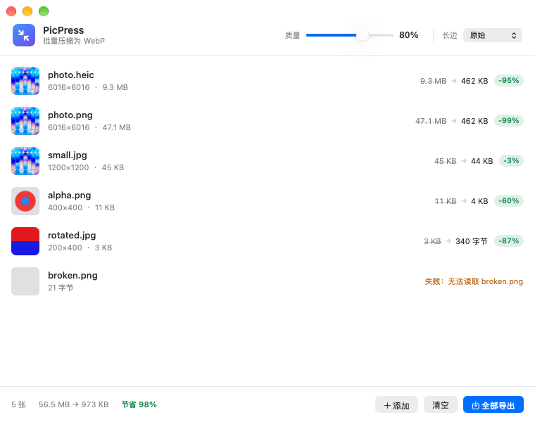
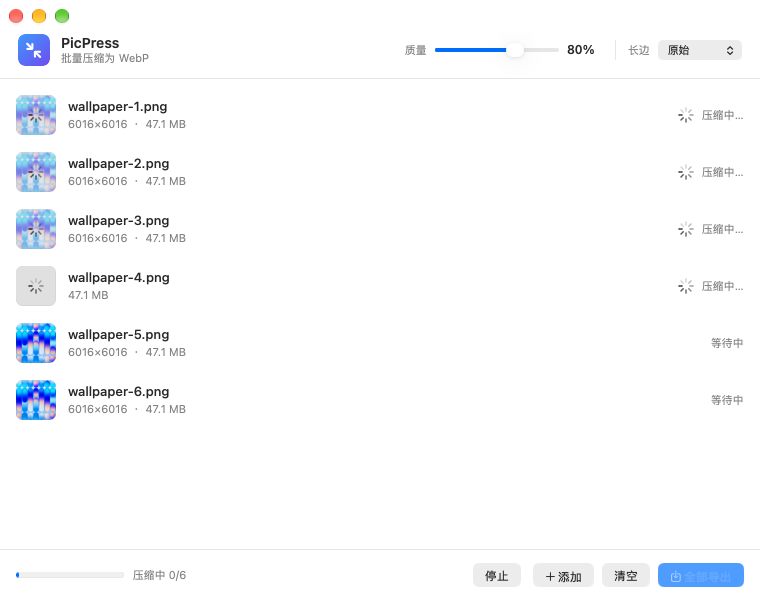
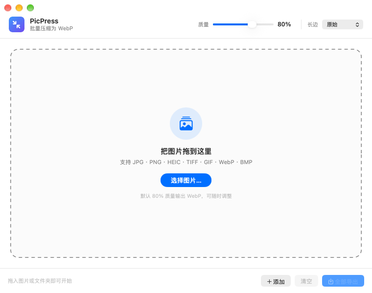

<div align="center">


# PicPress

**把图片拖进窗口，得到 80% 质量的 WebP。**

原生 macOS 批量图片压缩工具，1 MB 不到，不联网、不留痕。




</div>

## 功能

- **批量拖拽** —— 拖入一批图片，或者整个文件夹（会递归展开）
- **默认 80% 质量 WebP** —— 滑块可调 40%–100%，松手立即按新质量重压
- **看得见的进度** —— 底部总进度条 + 每行的「压缩中 / 等待中 / 完成」状态
- **批量下载** —— 一键导出全部到任意文件夹；也可以单张导出，或者直接把行拖到访达
- **长边限制** —— 原始 / 4096 / 2048 / 1600 / 1280 / 800，发博客、发微信前顺手缩小
- **透明通道无损** —— 带 alpha 的 PNG 保留透明；不透明图片不会白白多写一层 alpha
- **自动纠正 EXIF 方向** —— 手机竖拍的照片不会躺倒
- **并行压缩** —— 最多 4 个任务同时跑，随 CPU 核数自适应；随时可停止
- **体积对比** —— 每行显示 `原大小 → 新大小` 和 `-95%` 徽标，底部汇总总节省
- **完全本地** —— 没有任何网络请求，不上传、不统计

## 安装

### 下载现成的 App

到 [Releases](../../releases) 下载 `PicPress-1.0.0.zip`，解压后把 **PicPress.app** 拖到「应用程序」。

第一次打开会被 Gatekeeper 拦一下（App 是本地 ad-hoc 签名，没有 Apple 开发者账号），
**右键 → 打开** 即可，或者执行：

```bash
xattr -dr com.apple.quarantine /Applications/PicPress.app
```

> 需要 macOS 14 Sonoma 或更高版本。

### 从源码构建

只需要 **Xcode Command Line Tools** —— 不需要完整 Xcode，也不需要 Homebrew。

```bash
git clone https://github.com/dcchanInSz/PicPress.git
cd PicPress
make            # 构建 dist/PicPress.app 和 dist/picpress-cli
open dist/PicPress.app
```

首次构建会自动下载 libwebp 1.5.0 源码（带 SHA-256 校验）并编译成静态库，
之后的构建都会复用 `.build/` 里的产物。

### 命令行版

`make` 会顺带构建一个同引擎的 CLI，适合脚本和批处理：

```bash
dist/picpress-cli -q 80 -m 2048 -o out/ ~/Pictures/旅行
```

```
PicPress · 4 个文件 · 质量 80% · libwebp 1.5.0
──────────────────────────────────────────────────────────────────────────────
  photo.heic                        9.3 MB →     462 KB    -95%  6016×6016     1553 ms
  photo.png                        47.1 MB →     462 KB    -99%  6016×6016     1658 ms
  photo.tiff                      113.2 MB →     462 KB   -100%  6016×6016     1534 ms
  small.jpg                          45 KB →      44 KB     -3%  1200×1200       80 ms
──────────────────────────────────────────────────────────────────────────────
  合计   169.7 MB →     1.4 MB    -99%
```

## 使用

1. 把图片或文件夹拖进窗口（也可以 ⌘O 选择，或右键「打开方式 → PicPress」）
2. 需要的话调质量 / 长边 —— 改完会自动重压
3. 进度跑完后点 **全部导出…**（⌘E），选个文件夹即可

| 操作 | 说明 |
| --- | --- |
| 拖到列表行上 | 把压缩后的 WebP 拖进访达或别的 App |
| 双击某行 | 在访达中定位文件 |
| 右键某行 | 导出这一张 / 在访达中显示 / 重试 / 移除 |
| ⌘O / ⌘E / ⇧⌘⌫ | 添加图片 / 全部导出 / 清空列表 |

<div align="center">


</div>

## 压缩效果

同一张 6016×6016 的原图，在质量 80% 下的输出体积：

| 输入格式 | 输入体积 | 输出 WebP | 节省 |
| --- | --- | --- | --- |
| HEIC | 9.3 MB | 462 KB | -95% |
| JPEG | 6.4 MB | 466 KB | -93% |
| PNG | 47.1 MB | 462 KB | -99% |
| TIFF | 113.2 MB | 462 KB | -100% |

质量滑块的效果（同一张图，保持原始尺寸）：

| 质量 | 体积 |
| --- | --- |
| 40% | 254 KB |
| 60% | 310 KB |
| 80% | 466 KB |
| 95% | 4.0 MB |

## 实现细节

- **解码**：ImageIO。JPG / PNG / HEIC / HEIF / TIFF / GIF / BMP / AVIF / WebP / PSD… 都由系统解码器处理；
  `kCGImageSourceCreateThumbnailWithTransform` 顺带把 EXIF 方向转正、按长边限制降采样
- **编码**：libwebp 1.5.0 静态链接（不依赖 Homebrew），`WebPConfig.method = 5`，
  alpha 以无损方式编码；图片没有透明像素时 libwebp 不会写 ALPH 块
- **像素管线**：CoreGraphics 统一转成 RGBA8 → 预乘 alpha 还原为非预乘 → 交给 libwebp
- **并发**：`withTaskGroup` + 最多 4 个并行任务（不超过 CPU 核数），编码全部在后台线程
- **构建**：`swiftc` + `clang` + `iconutil`，仓库里没有 `.xcodeproj`，纯命令行可复现

## 项目结构

```
Sources/PicPress/            App 源码（AppKit + 手写 Auto Layout）
  ImageCompressor.swift      解码 → RGBA → libwebp 的核心管线
  CompressionQueue.swift     队列、并发、进度、导出
  MainViewController.swift   窗口布局与拖放
  FileListView.swift         列表与行复用
  ...
Sources/PicPressCLI/         命令行工具（同一引擎）
Sources/PicPressTests/       集成测试（20 项断言）
Sources/PicPressSnapshot/    离屏渲染窗口截图，用来检查界面
scripts/                     build / icon / test / snapshot 脚本
Resources/                   Info.plist、AppIcon.icns
```

## 开发

```bash
make             # 构建 App + CLI
make test        # 集成测试：编码器、队列、导出、错误处理
make snapshot    # 把窗口离屏渲染成 PNG（不需要截屏权限）
make icon        # 重新生成图标
make dmg         # 打包 dist/PicPress.dmg
make help        # 列出所有目标
```

## 许可

[MIT](LICENSE) © 2026 dcchanInSz
